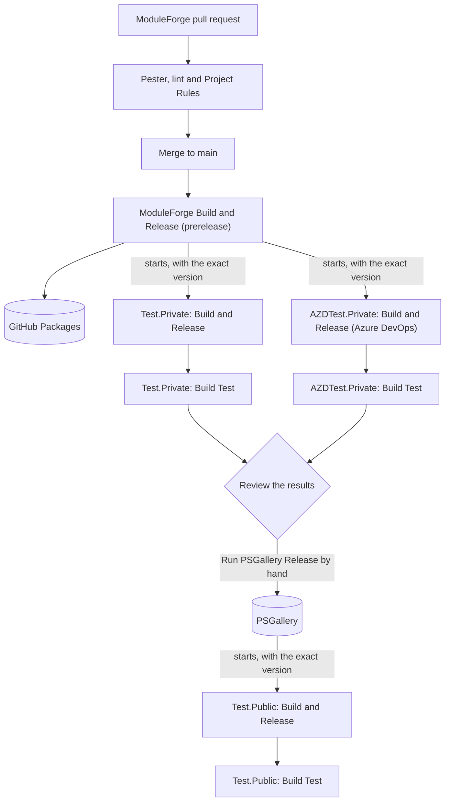
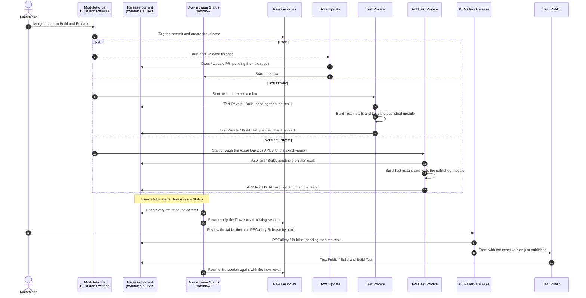

# How ModuleForge Tests Itself

ModuleForge has a large Pester suite, and [builds and releases itself](./SelfBuild.md). Neither proves the thing that matters most: that a module **built with** a new ModuleForge works once it's published and installed, on each platform ModuleForge supports.

So every ModuleForge build is also tested from the outside, by separate repositories that use ModuleForge the way you do: they scaffold with it, build with it, publish with it, install the result from a real package feed, and test what they installed. This runs automatically for every ModuleForge build.

It earns its keep. During 1.4, a prerelease stopped exporting aliases made with `Set-Alias`. Every ModuleForge unit test passed. A test repository's Build Test caught it, because it was the first thing to install a module built by that prerelease and try to call the alias.

---

## The test repositories

Each one builds the same example module, AstroCmdlets from the [advanced tutorial](../tutorials/github/github-tutorial-02-full-ModuleForge-Featureset.md), so it uses classes, an enum, a validation class, a private function, a resource file and an alias. Each has its own module name, so their packages never collide in a shared feed.

| Repository | Platform | Gets ModuleForge from | Proves |
| --- | --- | --- | --- |
| [ModuleForge.Test.Public](https://github.com/adrian-andersson/ModuleForge.Test.Public) | GitHub Actions | **PSGallery** | The version users install works, through the same path they use |
| ModuleForge.Test.Private | GitHub Actions | **GitHub Packages**, the newest prerelease | A prerelease works, before it's published anywhere public |
| ModuleForge.AZDTest.Private | Azure DevOps | **GitHub Packages**, the newest prerelease | The Azure DevOps scaffold and pipelines work, end to end |

**Why two are private.** They install ModuleForge prereleases from ModuleForge's GitHub Packages feed, which needs credentials, and they publish a stream of throwaway test versions of their own. Keeping them private keeps those tokens, feeds and test packages out of public view, where they would only confuse people. Test.Public deliberately stays public: it's the worked example you can read and copy.

Each repository's pipelines start from the ModuleForge scaffold, changed only where they need to point at the ModuleForge under test. That way the scaffold itself is tested too.

---

## How it flows

There are two stages, with a deliberate gap between them.

1. **Every build, automatically.** When ModuleForge's Build and Release publishes a version, usually a prerelease, it starts Build and Release in Test.Private and AZDTest.Private, passing the exact version it just published. Each builds its module with that version, publishes it to its own feed, and runs [Build Test](../tutorials/build-test.md) against the installed result.
2. **Every PSGallery release, by hand.** Publishing to PSGallery is a decision, not a side effect: several prereleases can build up before one is promoted, and a PSGallery version can never be deleted, only unlisted. Once it's published, PSGallery Release starts Test.Public, which installs that exact version from PSGallery and runs its Build Test. If that fails, the version is unlisted by hand.

A few principles hold throughout:

- **The exact version is passed at every step.** Each test repository builds with the version that was just published, never "whatever is newest", so a result always belongs to a specific build.
- **Starting a test never fails a release.** If a test repository can't be started, the release that triggered it still succeeds, with a warning. The release has already happened, and a broken trigger shouldn't hide that.
- **Each trigger has its own narrowly scoped token.** One that can start Test.Private's pipeline can't touch the others, or push code.
- **Every result comes back to the release.** Each check reports to the ModuleForge release it tested, so its page shows how it did everywhere. See [Results on every release](#results-on-every-release).

---

## Results on every release

Every ModuleForge release page ends with a **Downstream testing** table, filled in as the checks run. Nobody writes it: each check reports its own result, and the release page is redrawn from them.

It looks like this on a release:

| Check | Result | Notes | Updated (UTC) |
| --- | --- | --- | --- |
| AZDTest / Build | ✅ | automatic: Built and published | 11-28 11:35 |
| AZDTest / Build Test | ✅ | automatic: 26 tests passed | 11-28 11:35 |
| Docs / Update PR | ✅ | automatic: Docs PR #96 opened | 11-28 11:34 |
| Test.Private / Build | ✅ | automatic: Built and published | 11-28 11:34 |
| Test.Private / Build Test | ✅ | automatic: 26 tests passed | 11-28 11:35 |

### How it works

- **Each check reports as a commit status** on the release's commit, named `downstream/<check> (<version>)`: once as pending when it starts, then with its result. Statuses are GitHub's standard way for outside systems to report on a commit, and they show beside the commit as well.
- **The version is part of the name,** because promoting a prerelease to stable can tag the same commit twice. Each release's table shows only the results for its own version.
- **A workflow redraws the table** whenever a result arrives. It reads every result on the commit and rewrites only its own section of the notes, between hidden markers, so the changelog, checksums and anything added by hand stay as they are. Results that arrive together can't overwrite each other, as the table is rebuilt from all of them each time.
- **Only runs asked to test a specific ModuleForge version report.** ModuleForge's own triggers always pass one, and so can someone re-testing a release by hand, which the table labels *manual*. A test repository's own builds, and dry runs, never report.
- **Not every check runs for every release.** A check only gets a row once it has run, so Test.Public's rows appear only after a PSGallery publish.

### Why it can be trusted

- **The test repositories can only post statuses.** Each has its own token, with only the *Commit statuses* permission on ModuleForge. It can't read or change code, releases or branches.
- **Only expected results are shown.** The table only accepts results from the repository owner and ModuleForge's own workflows, so another app or integration can't add rows.
- **Reported text is shown as plain text.** No links, images, HTML or mentions from a result reach the page, and only `https://` links to runs are added.
- **Private repositories stay private.** Their results carry no links and no private names, only counts such as "26 tests passed".
- **Reporting never fails a run.** If a result can't be sent, the run warns and carries on.

---

## What it covers

Together with ModuleForge's own unit tests, this proves for each build:

- projects scaffolded by it have working pipelines, on GitHub and on Azure DevOps,
- it builds a module that installs from GitHub Packages, Azure Artifacts and PSGallery,
- the installed module exports exactly what its source declares, including aliases,
- classes, enums, validation attributes, private functions and resource files all work once installed,
- the build, publish, tag and test steps work when triggered by another pipeline, not just by hand.

---

## Replicating it for your own modules

You probably don't need all of this. For most modules, [Build Test](../tutorials/build-test.md) on its own gives the most important part: checking the module you published, not just your source.

It becomes worth more when other things depend on your module, such as a shared library several teams build on, or when it needs to work on more than one platform. The idea carries over, even if the details don't:

1. **Test what you published, not what you built.** Install from the real feed, by name, in a clean job, and test that.
2. **Add a consumer.** A separate repository that uses your module the way its users do, and has its own tests. It catches what your own tests are too close to see.
3. **Pass the exact version along.** Have your release start the consumer's pipeline, with the version it just published, so every result is tied to one build.
4. **Give each trigger the smallest token that works,** and never let a failed trigger fail the release that started it.
5. **Keep promotion manual.** Automate the testing, and decide yourself when something goes public.
6. **Report results back to the release.** A commit status from each consumer, and a small workflow that turns them into a table in the release notes, puts every result on one page. ModuleForge's `downstreamStatus.yml` and `.github/scripts` show how.

The mechanisms ModuleForge uses for the triggers are standard: a GitHub `repository_dispatch` or `workflow_dispatch` event between GitHub repositories, and the Azure DevOps [Runs API](https://learn.microsoft.com/rest/api/azure/devops/pipelines/runs/run-pipeline) from GitHub to Azure DevOps. ModuleForge's own `buildandrelease.yml` and `psgalleryRelease_NoModuleForge.yml` workflows show them in use.

---

## Related

- [ModuleForge Builds Itself](./SelfBuild.md)
- [Testing the Published Module (Build Test)](../tutorials/build-test.md)
- [CI Security Model](./CISecurityModel.md)
