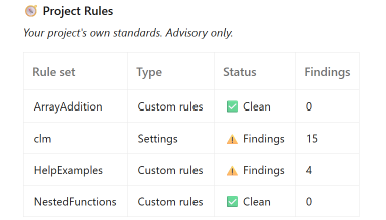

# Project Rules

The default PSScriptAnalyzer lint checks your code follows common PowerShell practice. **Project Rules** checks it follows *your* standards: rules your team or organization cares about that a general-purpose linter doesn't, such as code that must run under Constrained Language Mode, or every public function having a help example.

It is optional, additive and advisory:

- **Optional.** Nothing runs until you add rules and enable the workflow.
- **Additive.** It runs only the rules you give it, never the default ones again, and posts its own pull request comment beside the default lint comment.
- **Advisory.** Findings are reported, never a reason to fail a pull request.

---

## Quick start: `Add-MFProjectRules`

```powershell
Add-MFProjectRules
```

This adds four ready-made rule sets to a `PSScriptAnalyzer` folder in your project root, and enables the Project Rules workflow (GitHub) or pipeline (Azure DevOps) in whichever CI folders your project has, by renaming `projectRules.yml.example` to `projectRules.yml`. On Azure DevOps you still need to create a pipeline for the file, and add it to your branch policy, as with the others.

Pick rule sets with `-RuleSet`:

```powershell
Add-MFProjectRules -RuleSet CLM
```

| Rule set | Adds | Checks |
| --- | --- | --- |
| `CLM` | `PSScriptAnalyzer/clm.psd1` | Compatibility with [Constrained Language Mode](https://learn.microsoft.com/powershell/module/microsoft.powershell.core/about/about_language_modes), with PSScriptAnalyzer's `PSUseConstrainedLanguageMode` rule. Needs PSScriptAnalyzer 1.25.0 or newer |
| `HelpExamples` | `PSScriptAnalyzer/rules/HelpExamples/HelpExamples.psm1` | Every public function, in `source/functions`, has at least one `.EXAMPLE` in its comment-based help. Your docs are generated from that help, and an example is the first thing most people look for |
| `ArrayAddition` | `PSScriptAnalyzer/rules/ArrayAddition/ArrayAddition.psm1` | `+=` on an array, which copies the whole array each time, and recommends a generic list or collecting a loop's output instead. A Warning in a loop, Information elsewhere. Only variables the same function sets up as an array are checked, so `+=` on numbers and strings is left alone |
| `NestedFunctions` | `PSScriptAnalyzer/rules/NestedFunctions/NestedFunctions.psm1` | A function defined inside another function or a class method, which can't be tested or reused on its own. Move it to its own file, such as in `source/private`. Functions inside a script block, such as one passed to `Start-Job`, are left alone |

`New-MFProject -ProjectRules` adds all four when it creates a project.

To keep a finding on purpose, suppress it on the function it's in, with the rule's name:

```powershell
[Diagnostics.CodeAnalysis.SuppressMessageAttribute('Measure-MFNestedFunction', '', Justification = 'Why')]
```

Existing files are kept unless you pass `-Force`. A CLM finding is a prompt, not proof: a clean static check doesn't guarantee your module works under CLM, so test it there too if it matters.

---

## How it decides what to run

The files in `PSScriptAnalyzer/` decide everything. Each one is a **rule set**, with its own line in the report:

| File | Is |
| --- | --- |
| `PSScriptAnalyzer/*.psd1` | A [settings file](https://learn.microsoft.com/powershell/utility-modules/psscriptanalyzer/using-scriptanalyzer) naming the rules to run, in `IncludeRules` or `Rules` |
| `PSScriptAnalyzer/rules/<Name>/` | A custom rule module |

With no files, Project Rules does nothing and posts no comment. With all four ready-made rule sets, the comment on a pull request looks like this:



Below the table, each rule set with findings gets its own short tables: the most common findings, and the files with the most.

It scans `source/functions`, `private`, `classes`, `enums` and `validationClasses`. That is wider than the default lint, as a class anywhere in a module can matter as much as a function.

So it never repeats the default lint:

- A settings file only runs the rules it names. Naming a default rule is the one way to run it here.
- `IncludeDefaultRules`, `CustomRulePath` and `RecurseCustomRulePath` are ignored in settings files. Custom rules belong in the `rules` folder.
- A `PSScriptAnalyzerSettings.psd1` beside a source file isn't picked up.

A rule set that reports nothing is only shown as clean when it can be shown to have run. A misspelled rule name, or a missing `Enable = $true`, also produces zero findings, and the report says so rather than calling it clean.

---

## Writing your own rules

A custom rule is a PowerShell module of `Measure-*` functions that take an AST and return diagnostic records. The `HelpExamples` rule is a short, complete example to copy:

```powershell
# PSScriptAnalyzer/rules/MyRules/MyRules.psm1
function Measure-MyRule
{
    [CmdletBinding()]
    [OutputType([Microsoft.Windows.PowerShell.ScriptAnalyzer.Generic.DiagnosticRecord[]])]
    PARAM(
        [Parameter(Mandatory)]
        [System.Management.Automation.Language.ScriptBlockAst]$ScriptBlockAst
    )
    process{
        # Inspect $ScriptBlockAst, and for each problem output a DiagnosticRecord:
        # [Microsoft.Windows.PowerShell.ScriptAnalyzer.Generic.DiagnosticRecord]@{
        #     Message = '...'; Extent = $someAst.Extent; RuleName = 'Measure-MyRule'; Severity = 'Warning'
        # }
    }
}
Export-ModuleMember -Function Measure-*
```

See [Creating custom rules](https://learn.microsoft.com/powershell/utility-modules/psscriptanalyzer/create-custom-rule) in the PSScriptAnalyzer docs for the details.

> **Custom rules are code, and they run in CI.** The workflow runs them in a job with read-only access and no write token, and posts the comment from a separate job that never runs your code. Even so, treat `PSScriptAnalyzer/` like workflow files: consider adding it to `CODEOWNERS`, so changes to it need review.

---

## Run it locally

Project Rules is a script in your project, so you can run exactly what CI runs before you open a pull request:

```powershell
# Each finding, with its line number
.\scripts\Invoke-MFProjectRules.ps1

# The same markdown report CI posts to a pull request
(.\scripts\Invoke-MFProjectRules.ps1).Report
```

---

## Related

- [`Add-MFProjectRules`](../functions/Add-MFProjectRules.md)
- [CI Security Model](./CISecurityModel.md)
- [PowerShell Style Recommendations](./PowerShellStyle.md)
