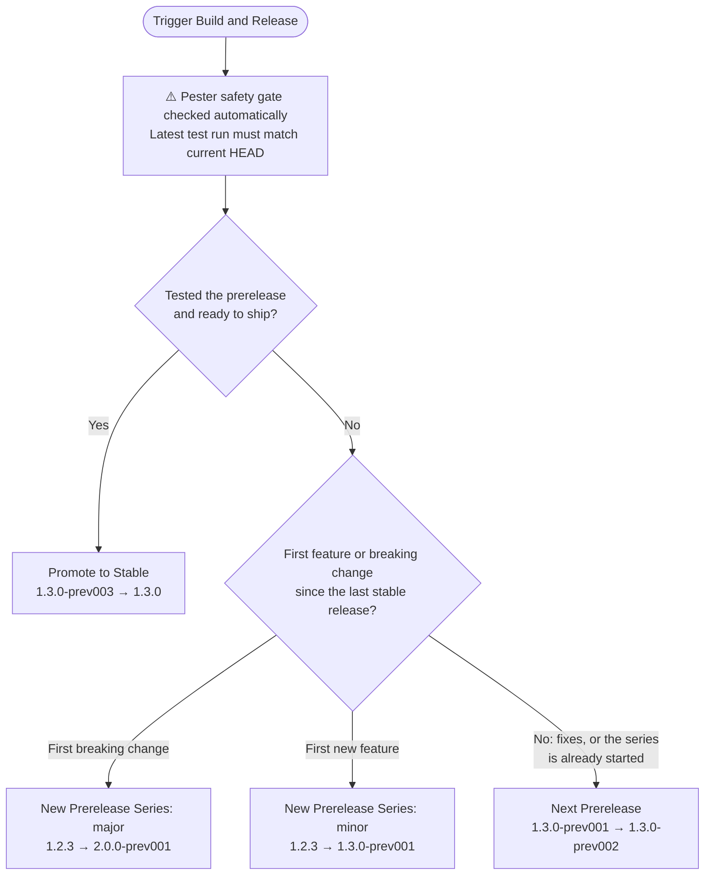

# Build and Release Guide

The **Build and Release** workflow is triggered manually from GitHub Actions (`Actions → Build and Release → Run workflow`), or by running the Build and Release pipeline in Azure DevOps. It versions, builds, and publishes your module to your package feed, and on GitHub creates a release with notes built from your commits.

This guide is the full reference for its inputs. For the practical version, what to pick from one run to the next, start with [Making the Most of Releases](./tutorials/releases.md). The short answer: **most runs use Next Prerelease, the default.**

> This page describes the Build and Release form from ModuleForge 1.4.1. Projects scaffolded with an earlier version have the older `version_type` and `release_type` inputs until they [update their workflows](./tutorials/updating-scaffold.md).

---

## Before You Trigger

The workflow checks a safety gate before it does anything else: the most recent Pester test run must have passed **and** its commit SHA must match the current HEAD on `main`. If your last Pester run was against an older commit, or if tests are failing, the workflow exits immediately.

> Merge your PR, confirm the automatic Pester run passed, then trigger Build and Release.

---

## The Inputs

One input decides the version: **Release**, below. The others are marked **Advanced** and rarely change:

| Input | Default | What it does |
| --- | --- | --- |
| `dependency_source` | `required-resource-file` | Where ModuleForge itself is installed from for the build: the version pinned in `BuildDependencies.psd1`, or the latest (`psgallery-latest`) or latest prerelease (`psgallery-prerelease`) from PSGallery. See [Build Dependencies](./Concepts/BuildDependencies.md) |
| `include_source_metadata` | On | Adds the branch and commit the build came from to the package metadata |
| `feed_name` *(Azure DevOps only)* | `psPackages` | The Azure Artifacts feed to publish to. It can be scoped to the project or the organization |
| `dry_run` | Off | Works out the version and builds, then stops before anything is tagged, released or published. See [Dry runs](#dry-runs) |

### Release - What are you releasing?

A release follows the same path every time: **start a series once, run Next Prerelease until it's ready, then Promote to Stable.**

| Choice | What it does | Example |
| --- | --- | --- |
| **Next Prerelease** *(default)* | Continues the current prerelease series. From a stable version, starts a patch series | `1.2.3-prev002 → 1.2.3-prev003`<br>`1.2.3 → 1.2.4-prev001` |
| **New Prerelease Series: minor** | Starts a minor series, for the first new feature since the last stable release | `1.2.3 → 1.3.0-prev001`<br>`1.2.4-prev002 → 1.3.0-prev001` |
| **New Prerelease Series: major** | Starts a major series, for the first breaking change since the last stable release | `1.2.3 → 2.0.0-prev001`<br>`1.3.0-prev002 → 2.0.0-prev001` |
| **Promote to Stable** | Releases the current prerelease as a stable version | `1.2.3-prev003 → 1.2.3` |

Each choice shows the same example in brackets in the form, such as `(x.y.z-prevN -> prevN+1)`. Only the text before the bracket counts, so you can reword the brackets, but keep the choice names.

> **Start a series only once.** A New Prerelease Series always increments from the current version, so choosing minor again inside a minor series skips a version: `1.3.0-prev002 → 1.4.0-prev001`. Every later pull request in the series is Next Prerelease. A series can still move up: if a breaking change arrives during a minor series, New Prerelease Series: major moves it to the next major version.

Prereleases are published to your feed but are hidden from `Find-PSResource` / `Find-Module` unless `-AllowPrerelease` is explicitly passed. Use them to validate across environments before committing to a stable version.

---

## Decision Flowchart



---

## Common Scenarios

### "This is my first release"

Starting fresh on a brand new module - no tags exist yet.

**Release:** Next Prerelease

Result: `1.0.1-prev001`. With no version tags yet, ModuleForge treats the current version as `1.0.0`. Lets you validate the build pipeline before shipping anything.

### "I merged a bug fix PR and want to test it"

**Release:** Next Prerelease

Result: e.g. `1.2.3 → 1.2.4-prev001` after a stable release, or `1.2.4-prev001 → 1.2.4-prev002` during a series. The module is published to your feed but marked as prerelease.

### "I merged the first new function since the last stable release"

**Release:** New Prerelease Series: minor

Result: e.g. `1.2.3 → 1.3.0-prev001`, or `1.2.4-prev002 → 1.3.0-prev001` if a patch series was already running. The bug fixes in that patch series come along too.

### "I merged another new function in the same series"

**Release:** Next Prerelease

Result: e.g. `1.3.0-prev001 → 1.3.0-prev002`. The series already says minor, so there's nothing to start.

### "I've tested the prerelease and it's good - ship it"

**Release:** Promote to Stable

Result: e.g. `1.3.0-prev002 → 1.3.0`. Promotes the prerelease to stable and creates a GitHub Release with the changelog. If the latest version is already stable, the workflow stops with a message, as there's no prerelease to promote.

---

## Releasing Stable Without a Prerelease

The form doesn't offer this by default, so it's always a deliberate choice. To enable it, uncomment the **Stable Release** options in your workflow file (`.github/workflows/buildandrelease.yml` or `.azuredevops/pipelines/buildAndRelease.yml`):

| Choice | Example |
| --- | --- |
| **Stable Release: patch** | `1.2.3 → 1.2.4` |
| **Stable Release: minor** | `1.2.3 → 1.3.0` |
| **Stable Release: major** | `1.2.3 → 2.0.0` |

Only skip prerelease validation if you have high confidence, for example when the change is trivial or well covered by tests.

---

## Dry Runs

Tick **dry run** to see what a run would do without doing it. The workflow works out the version and builds the module, then stops before anything is tagged, released or published. The Docs Update and Build Test workflows skip dry runs.

It's a safe way to check what a choice will give you before a real run.

---

## The Release Plan

Every run, dry or not, writes a release plan at the top of its summary page: the latest version, the release you chose, and the version it will build. On GitHub the run is named after the release you chose, and on Azure DevOps it's named after the version. Both are marked when it's a dry run.

---

## What Happens After a Stable Release

When you Promote to Stable, the workflow:

1. Tags the commit with `v{version}` (e.g. `v1.3.0`)
2. Publishes the module package to your GitHub Packages feed
3. Creates a GitHub Release with changelog entries generated from commit prefixes
4. The release appears on the **Code** tab with the `Latest` badge

Prerelease builds are also published to GitHub Packages but create a pre-release GitHub Release (marked as pre-release, no `Latest` badge).

---

## Prerelease Version Format

ModuleForge uses zero-padded three-digit counters to ensure correct lexicographic ordering:

```
1.3.0-prev001
1.3.0-prev002
...
1.3.0-prev010   ← sorts correctly after prev009
```

The label `prev` is lowercase by design - there is a known PSResourceGet bug where uppercase prerelease labels cause incorrect behaviour on some feeds.

See [Module Versioning with SemVer](./Concepts/ModuleVersioning_With_SemVer.md) for the full explanation of the versioning rules and PSGallery constraints.

---

## Related

- [Making the Most of Releases](./tutorials/releases.md) - what to pick from one run to the next
- [Commit Prefixes](./commit-prefixes.md) - which prefixes map to which changelog sections and types of change
- [Commit Strategy and PR Process](./Concepts/CommitStrategy_And_PRProcess.md) - how the PR template connects to the Release choice
- [Module Versioning with SemVer](./Concepts/ModuleVersioning_With_SemVer.md) - detailed SemVer rules and PSGallery constraints
