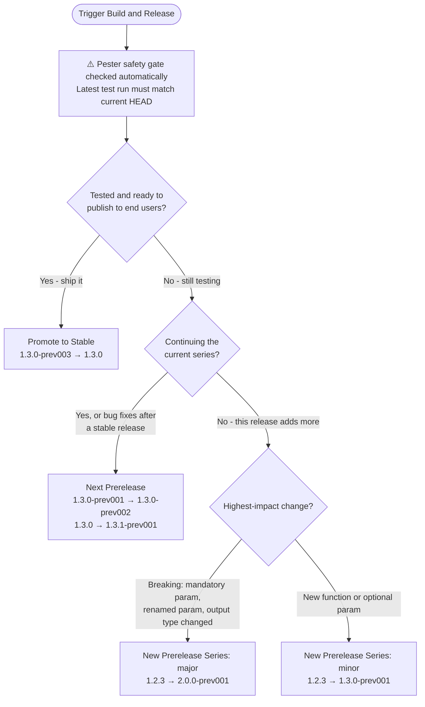
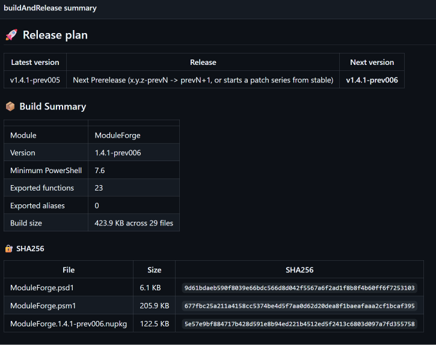

# Build and Release Guide

The **Build and Release** workflow is triggered manually from GitHub Actions (`Actions → Build and Release → Run workflow`), or by running the Build and Release pipeline in Azure DevOps. It versions, builds, and publishes your module to your package feed, and on GitHub creates a release with notes built from your commits.

This guide is the full reference for its inputs. For the practical version, what to pick from one run to the next, start with [Making the Most of Releases](./tutorials/releases.md). The short answer: **most runs use `Next Prerelease`, the default.**

> This page describes the form from ModuleForge 1.4.1. Projects scaffolded earlier have `version_type` and `release_type` inputs instead until they [update their workflows](./tutorials/updating-scaffold.md). [Updating an older workflow](#updating-an-older-workflow) maps the old inputs to the new choices.

---

## Before You Trigger

The workflow checks a safety gate before it does anything else: the most recent Pester test run must have passed **and** its commit SHA must match the current HEAD on `main`. If your last Pester run was against an older commit, or if tests are failing, the workflow exits immediately.

> Merge your PR, confirm the automatic Pester run passed, then trigger Build and Release.

---

## The Inputs

One input decides the version: **`release`**, below. The rest are marked **Advanced** and rarely change:

| Input | Default | What it does |
| --- | --- | --- |
| `release` | `Next Prerelease` | What you're releasing. See [The release choices](#the-release-choices) |
| `dependency_source` | `required-resource-file` | Where ModuleForge itself is installed from for the build: the version pinned in `BuildDependencies.psd1`, or the latest (`psgallery-latest`) or latest prerelease (`psgallery-prerelease`) from PSGallery. See [Build Dependencies](./Concepts/BuildDependencies.md) |
| `include_source_metadata` | On | Adds the branch and commit the build came from to the package metadata |
| `feed_name` *(Azure DevOps only)* | `psPackages` | The Azure Artifacts feed to publish to. It can be scoped to the project or the organization |
| `dry_run` | Off | Works out the version and builds, then stops before anything is tagged, released or published. See [Dry runs](#dry-runs) |

---

## The release choices

A release is a **prerelease series**: you start the series once, build as many prereleases as you need, then promote the last one to stable. The choices follow that order:

| Choice | Example result | When to use |
| --- | --- | --- |
| **Next Prerelease** | `1.3.0-prev001 → 1.3.0-prev002`, or from stable `1.2.3 → 1.2.4-prev001` | Almost every run. Continues the current series. After a stable release, it starts a patch series, so bug fixes never need anything else |
| **New Prerelease Series: minor** | `1.2.3 → 1.3.0-prev001`, or from a patch series `1.2.4-prev002 → 1.3.0-prev001` | Once, on the first build with a new function or optional parameter |
| **New Prerelease Series: major** | `1.2.3 → 2.0.0-prev001` | Once, on the first build with a breaking change |
| **Promote to Stable** | `1.3.0-prev002 → 1.3.0` | When the series is tested and ready to ship |

Prereleases are published to your feed but are hidden from `Find-PSResource` / `Find-Module` unless `-AllowPrerelease` is explicitly passed. Use them to validate across environments before committing to a stable version.

> Start a series with the **highest-impact** change since your last stable release. If you added a new function (`minor`) and fixed a bug in the same release, choose `minor`. If a breaking change comes along part way through a minor series, start a new `major` series: `1.3.0-prev002 → 2.0.0-prev001`.

> **Start a series only once.** A New Prerelease Series always increments from the current version, so choosing minor again inside a minor series skips a version: `1.3.0-prev002 → 1.4.0-prev001`. Every later pull request in the series is Next Prerelease.

### Promoting a version that's already stable

**Promote to Stable** only promotes a prerelease. If the latest version is already stable, there's nothing to promote, so the run stops before it builds:

```text
❌ v1.3.0 is already stable, so there is no prerelease to promote. Run Next Prerelease or start a
New Prerelease Series first. To release a stable version without a prerelease series, uncomment the
Stable Release options in .github/workflows/buildandrelease.yml
```

### Stable releases without a prerelease series

Releasing straight to stable skips the step where you test what you're about to ship, so the form doesn't offer it by default. If your project wants it, uncomment the **Stable Release** choices in the workflow file (`.github/workflows/buildandrelease.yml`, or `.azuredevops/pipelines/buildAndRelease.yml`):

```yaml
          #To release a stable version without a prerelease series first, uncomment these. Needs ModuleForge 1.4.1 or newer
          - 'Stable Release: patch (x.y.z -> x.y.Z)'
          - 'Stable Release: minor (x.y.z -> x.Y.0)'
          - 'Stable Release: major (x.y.z -> X.0.0)'
```

| Choice | Example result |
| --- | --- |
| **Stable Release: patch** | `1.2.3 → 1.2.4` |
| **Stable Release: minor** | `1.2.3 → 1.3.0` |
| **Stable Release: major** | `1.2.3 → 2.0.0` |

They need ModuleForge 1.4.1 or newer in `BuildDependencies.psd1`, as earlier versions stopped with `version supplied does not contain a prerelease`.

The workflow reads the text before the bracket to decide what to do, so you can reword the examples in brackets, but keep each choice starting with `Next Prerelease`, `New Prerelease Series`, `Promote to Stable` or `Stable Release`.

---

## Decision Flowchart



---

## Dry runs

Turn on **`dry_run`** to see what a run would do without doing it. The workflow checks the Pester gate, works out the next version, writes the release plan and builds the module, then stops. Nothing is tagged, no release is created and nothing is published, so you can run it as often as you like.

A dry run is marked in the run's name (`- DRY RUN` on GitHub, `-dryrun` on Azure DevOps), and the Build Test and Docs Update workflows skip it, as there's no new package to test or document.

---

## The release plan

Every run, dry or not, starts its summary page with what it's going to do:

| Latest version | Release | Next version |
| --- | --- | --- |
| v1.3.0-prev002 | Promote to Stable (x.y.z-prevN -> x.y.z) | **v1.3.0** |

On GitHub it's at the top of the run's **Summary**, and the run is named after the release chosen. On Azure DevOps it's on the run's **Extensions** tab, and the run is named after the version.

A build summary follows it, with the version, what the module exports, and SHA256 checksums of the built files:



---

## Common Scenarios

### "This is my first release"

Starting fresh on a brand new module - no tags exist yet. Choose **Next Prerelease**.

Result: `1.0.1-prev001`. With no version tags yet, ModuleForge treats the current version as `1.0.0`. Lets you validate the build pipeline before shipping anything.

---

### "I merged a bug fix PR and want to test it"

Choose **Next Prerelease**.

Result: after a stable release, `1.2.3 → 1.2.4-prev001`. Part way through a series, `1.3.0-prev001 → 1.3.0-prev002`, and the fix ships with that series.

---

### "I've tested the prerelease and it's good - ship it"

Choose **Promote to Stable**.

Result: e.g. `1.2.4-prev002 → 1.2.4`. Promotes the prerelease to stable and creates a GitHub Release with the changelog.

---

### "I added two new functions"

Choose **New Prerelease Series: minor** on the first build with them, then **Next Prerelease** for each build after that, then **Promote to Stable**.

Result: `1.2.3 → 1.3.0-prev001 → 1.3.0-prev002 → 1.3.0`. The version was decided when the series started, so promoting it never needs a version choice.

---

### "I have several bug fixes ready - skipping prerelease"

Only skip prerelease validation if you have high confidence (e.g. the change is trivial or well-covered by tests). Uncomment the [Stable Release choices](#stable-releases-without-a-prerelease-series) first, then choose **Stable Release: patch**.

Result: e.g. `1.2.3 → 1.2.4` directly.

---

## What Happens After a Stable Release

When you choose **Promote to Stable** or a **Stable Release**, the workflow:

1. Tags the commit with `v{version}` (e.g. `v1.3.0`)
2. Publishes the module package to your GitHub Packages feed
3. Creates a GitHub Release with changelog entries generated from commit prefixes
4. The release appears on the **Code** tab with the `Latest` badge

Prerelease builds are also published to GitHub Packages but create a pre-release GitHub Release (marked as pre-release, no `Latest` badge).

---

## Prerelease Version Format

ModuleForge uses zero-padded three-digit counters to ensure correct lexicographic ordering:

```
1.3.0-prev001
1.3.0-prev002
...
1.3.0-prev010   ← sorts correctly after prev009
```

The label `prev` is lowercase by design - there is a known PSResourceGet bug where uppercase prerelease labels cause incorrect behaviour on some feeds.

See [Module Versioning with SemVer](./Concepts/ModuleVersioning_With_SemVer.md) for the full explanation of the versioning rules and PSGallery constraints.

---

## Updating an older workflow

Projects scaffolded before ModuleForge 1.4.1 have two inputs, `version_type` and `release_type`, and keep them until the workflow is updated. They map to the new choices like this:

| `version_type` | `release_type` | New choice |
| --- | --- | --- |
| `none` | `prerelease` | Next Prerelease |
| `minor` | `prerelease` | New Prerelease Series: minor |
| `major` | `prerelease` | New Prerelease Series: major |
| `patch` | `prerelease` | Next Prerelease, from a stable version |
| `none` | `stable` | Promote to Stable |
| `patch` / `minor` / `major` | `stable` | Stable Release, once uncommented |

To update, follow [Updating Your Workflows and Templates](./tutorials/updating-scaffold.md). It runs `Add-MFGithubScaffold -Force` or `Add-MFAzureDevOpsScaffold -Force` on a branch, and shows how to keep changes of your own, such as a `feed_name` default.

---

## Related

- [Making the Most of Releases](./tutorials/releases.md) - what to pick from one run to the next
- [Commit Prefixes](./commit-prefixes.md) - which prefixes map to which changelog sections and types of change
- [Commit Strategy and PR Process](./Concepts/CommitStrategy_And_PRProcess.md) - how the PR template connects to the Release choice
- [Module Versioning with SemVer](./Concepts/ModuleVersioning_With_SemVer.md) - detailed SemVer rules and PSGallery constraints
