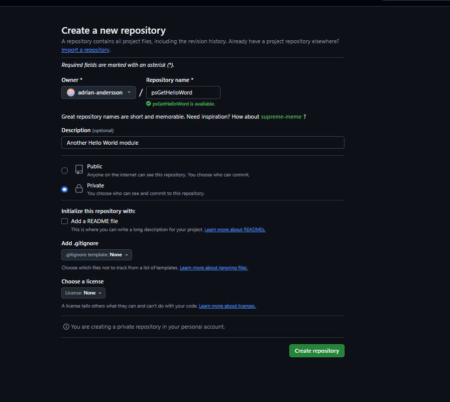
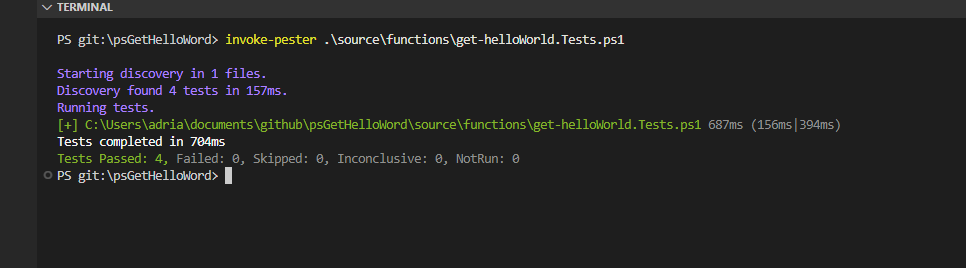
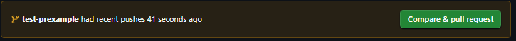
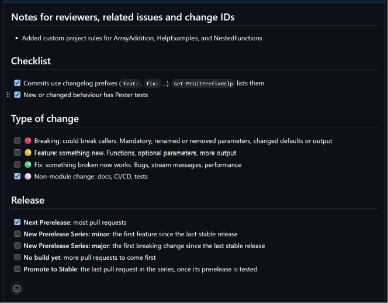
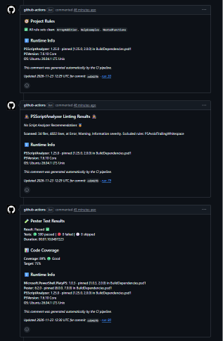
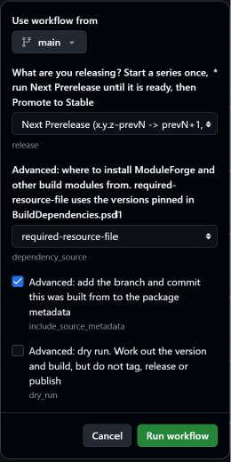
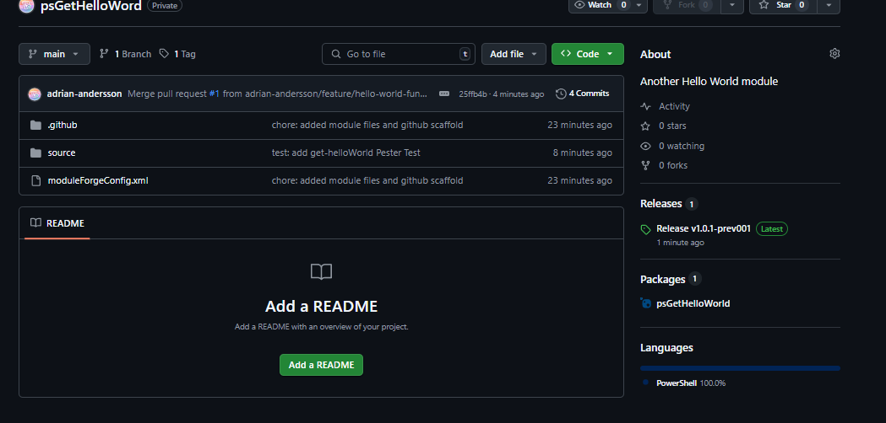
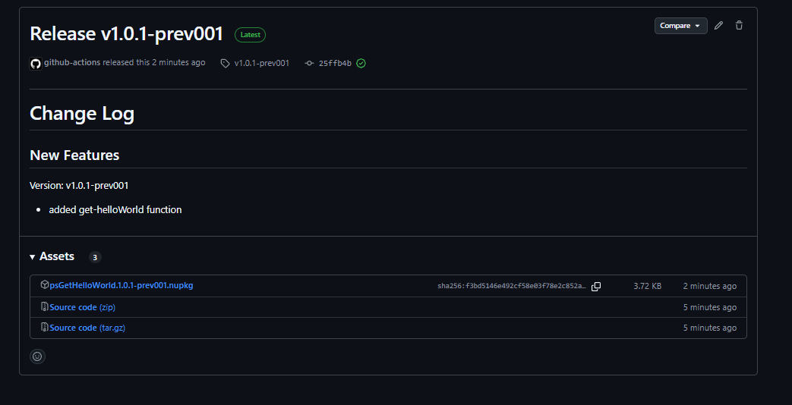

# Getting Started with ModuleForge and GitHub

This tutorial will demonstrate how to create a simple, single-function module using ModuleForge, with 1 pester test, and deploy via Github workflows.

## Part 0 - Local Environment Setup

1. Setup your local workspace. You will need to have installed
    - PowerShell 7.6+
    - VSCode (or your IDE of choice)
        - If you use an IDE other than VSCode, you will need to correct the instructions in this tutorial accordingly
    - GIT commandline
2. Install PowerShell module dependencies. You will need the following modules from the PSGallery:
    - `Pester` 6.0+
    - `PSScriptAnalyzer` 1.25+
    - `Microsoft.PowerShell.PSResourceGet` 1.1.1+ (included with PowerShell 7.4 and newer)
    - `ModuleForge` 1.4.0+

> Note: All the required modules are cross-platform compatible. Your OS of choice does not matter.

Here is a code-snippet to help get you started

```powershell
Install-PSResource -repository PSGallery -Name Pester,PSScriptAnalyzer,ModuleForge
```

## Part 1 - New Repository

1. Login to your github account
2. Browse to your personal repositories and select 'Create a new repository'
3. Fill in the new repository details
   - Repository Name should be 'psGetHelloWorld'
   - Repository Description should be 'Another Hello World Module'
   - Repository should be private
    
4. Clone your repository to your local environment

> hint: If you are unsure of how to clone a repository, copy the URI from the browser address bar and use it with the `git clone` command, e.g. `git clone https://github.com/adrian-andersson/ModuleForge`

## Part 2 - Create a new ModuleForge Project

1. From your repository directory, run `New-MFProject` with `-Scaffold GitHub`, as per the example below. This builds the project files, and adds the GitHub Actions workflows and a PR template to the `.github` directory, in one step
2. Check you have created a `source` directory and a module config file `moduleForgeConfig.xml`. The source directory should have a number of subfolders
3. Check the `.github` directory was created. The active workflows run Pester, lint your code, and build and release your module. The files ending `.example` are optional extras you can enable later by renaming them
4. With your filestructure created and workflows added, commit and sync your repository back to origin\main
   - You should use a proper commit message, something like `chore: Initialised ModuleForge project with scaffolding & workflows'
  
```powershell
New-MFProject -ModuleName 'psGetHelloWorld' -description 'Another Hello World module' -Scaffold GitHub
```

> Adding ModuleForge to an existing project, or already ran `New-MFProject` without `-Scaffold`? Run `Add-MFGithubScaffold` to add the workflows on their own.

> **Optional: Project Rules.** Run `Add-MFProjectRules` before committing to add two ready-made rule sets, and enable the Project Rules workflow. On every pull request it then checks your code runs under Constrained Language Mode, and that every public function has a help example, as an advisory comment beside the lint results. See [Project Rules](../../Concepts/ProjectRules.md).

## Part 3 - Create a Function and a Test

### Creating our get-helloWorld function

1. Create a branch called `feature/hello-world-function`. You can deviate from this naming convention if you like. The objective is to be consistant.
2. Create a new file in the `functions` sub-directory of the `source` directory
   - Call the file `Get-HelloWorld.ps1`
3. Code up your powershell function code.
   - An example is provided below
   - Make sure you include some form of Inline Help and follow good coding practices

> Hint: In VSCode you can create a branch by clicking on the current branch name in the bottom left corner, then in the dialog box, selecting `+Create New Branch`. VSCode will automatically switch you to the new branch

```powershell
function Get-HelloWorld
{

    <#
        .SYNOPSIS
            Return Hello World
            
        .DESCRIPTION
            Return Hello World. Allows you to overwrite the default name of world with 
            
        .EXAMPLE
            Get-HelloWorld
            
            #### OUTPUT
            Returns "Hello World!"

        .EXAMPLE
            Get-HelloWorld -name 'James'
            
            #### OUTPUT
            Returns "Hello James!"
    #>

    [CmdletBinding()]
    PARAM(
        #Name param, specify to override the default of World
        [Parameter()]
        [string]$name = 'World'
    )
    begin{
        #Return the script name when running verbose, makes it tidier
        write-verbose "===========Executing $($MyInvocation.InvocationName)==========="
        #Return the sent variables when running debug
        Write-Debug "BoundParams: $($MyInvocation.BoundParameters|Out-String)"
        
    }
    
    process{
        "Hello $name!"
    }
    
}

```

### Creating our Pester Test

1. Create a new file in the `functions` sub-directory of the `source` directory
   - Call the file `Get-HelloWorld.Tests.ps1`
   - It is important that `Tests` is in the correct, capital-case format for `Invoke-Pester` to work.
2. Code up your Pester Test. You can use the example below
   - Don't forget to load your functions file in a before all block
   - This can be achieved dynamically with this little piece of code: `. $PSCommandPath.Replace('.Tests.ps1','.ps1')`

```powershell
BeforeAll{
    #Load The Function File
    . $PSCommandPath.Replace('.Tests.ps1','.ps1')
}

Describe "Get-HelloWorld Default Parameters" {
    BeforeAll {
        $hello = Get-HelloWorld
    }

    It 'Should not be null or empty' {
        $hello |Should -Not -BeNullOrEmpty
    }

    It 'Should contain "Hello World!"' {
        $hello |Should  -Be 'Hello World!'
    }
}

Describe "Get-HelloWorld Custom Name" {
    BeforeAll {
        $hello = Get-HelloWorld -name 'James'
    }

    It 'Should not be null or empty' {
        $hello |Should -Not -BeNullOrEmpty
    }

    It 'Should contain "Hello James!"' {
        $hello |Should  -Be 'Hello James!'
    }
}

```

### Run our Pester Test Locally

1. It is a good idea to test locally before we submit our code back to the repository
    - We can do that from our invoking pester from our working directory, as per below
    - If everything is working as intended, you should have passed the 4 tests (represented in our Pester test as 'It' blocks)

```powershell
Invoke-Pester '.\source\functions\Get-HelloWorld.Tests.ps1'
```



## Part 4 - Pull Request and BuildAndRelease

### Commit Changes

1. Commit _just_ our functions file with the `feat` commit prefix and a relevant comment
   - Something like `feat: added Get-HelloWorld function`
2. Now commit the pester test file using the `test` commit prefix
    - Something like `test: added Pester testing for Get-HelloWorld`
3. Publish your branch back to github

>Hint: If you are not sure how to commit in VSCode, switch to the `Source Control` item in the left-most menu. You will need to _stage_ each file by clicking the small plus sign next the the filename. Enter the _commit_ message into the text box labelled _changes_, when ready, hit _commit_. Once all your files are committed, you can publish your branch with the `Publish Branch` button that replaces the `Commit` button

### Create Pull Request

1. In your browser, navigate to your new repository. You should see a notification banner in the top of github advising that a new branch can be used to create a PR.
   - 
2. Click the option to create a Pull Request
3. Fill in the Pull Request template
   - Add notes for reviewers: anything your commits don't say
   - Tick every type of change the pull request includes. The highest-impact one guides the Release choice
   - Tick the Build and Release choice to run after it merges. Most pull requests are **Next Prerelease**
   - 
4. Once you have completed the PR template, create the Pull Request
5. On submission of a Pull Request to the Main branch, the Pester and ScriptAnalyzer workflows will automatically be invoked. The results will be added as comments to the PR
   - 
6. If everything is tracking well, our tests passed, there are no merge conflicts, and we should be ok to proceed to `Merge Pull Request`

> If you want to explore your pester results in more details before a merge, you can click on `Actions`, find the `pesterTest` workflow, and expand the `Run pester tests` step from our latest run to view things such as code coverage, or get more details on failures etc.

### Build and Release

1. With our Pull Request merged, navigate to `Actions` menu
2. Find and select the `Build and Release` workflow
3. This workflow has a `workflow_dispatch` event that we can use to version, build and release our code as a PowerShell module
4. Select the `Run Workflow` option, a menu will appear. Fill out the fields appropriately and then choose `run workflow`
   - Branch should be main
   - Since this is our first release, lets leave the type to increment as `none`
   - Type of release should be `prerelease`
   - 
5. Wait for our workload to finish.
6. Navigate back to the `code` tab after the workflow completes. You should now see:
   - A new Release with a version tag and a `latest` badge
   - Packages set at 1
   - 
7. Click on the release to see more details
   - The release should have created a changelog based on our commit messages
   - There should also be some artifacts, or assets, with the important one being the nupkg file. This file contains our module. 
   - 

> Don't forget to checkout the Main branch on your local working directory before adding any more code.

>If you want to manually download and install your new module, you can download the nupkg from the releases page, rename the extension to `.zip` and uncompress to find your module.

## Part 5 - Install locally with PSresourceGet

Your module is now in your GitHub Packages feed. To install it, you need a **classic** personal access token with only the `read:packages` scope, and to register the feed once on your machine:

```powershell
# Swap in your GitHub username or organization
Register-PSResourceRepository -Name 'myGithubPackages' -Uri 'https://nuget.pkg.github.com/<githubaccount>/index.json' -Trusted

# Your GitHub username, with the token as the password
$githubCredential = Get-Credential

# Your first build is a prerelease, so -Prerelease is needed to see it
Install-PSResource -Name psGetHelloWorld -Prerelease -Repository myGithubPackages -Credential $githubCredential
```

[Using Private Package Feeds](../private-package-feeds.md) covers the rest: storing the credential in a secret vault so you don't pass it each time, and the quirks worth knowing, such as no wildcard searches and lowercase install folders on Linux and macOS.

## Wrapping up

In this tutorial, we created a new repository, added our ModuleForge scaffolding, created a new PowerShell function + test, performed a review and unit test, and released it as a PreRelease into our private Github Packages repository for consumption. We effectively made a CI/CD PowerShell Pipeline using Github Actions + ModuleForge, and published a single-function module.

Ready to go further? The [Advanced ModuleForge Tutorial](./github-tutorial-02-full-ModuleForge-Featureset.md) covers the full source folder structure - enums, validation classes, classes with inheritance, private functions, and resource files. [Making the Most of Releases](../releases.md) explains which Build and Release options to pick as your module grows.

