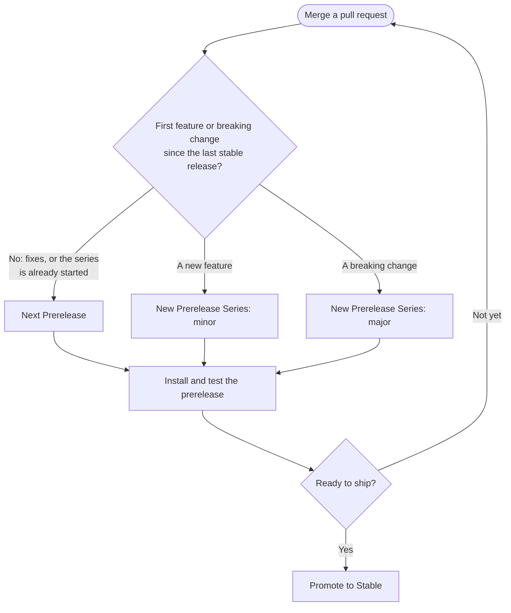

# Making the Most of Releases

The Build and Release form asks you to make a choice every time you run it, and it isn't obvious when to change it. This page is the practical version: what to pick, and when. The [Build and Release Guide](../build-and-release.md) has the full reference.

**The short version: leave the form at Next Prerelease for almost every run.** You start a series at most once per release, and Promote to Stable once, when you ship.

> This page describes the Build and Release form from ModuleForge 1.4.1. If your form still has `version_type` and `release_type`, [update your workflows](./updating-scaffold.md) to get it. [Updating an older workflow](../build-and-release.md#updating-an-older-workflow) maps the old inputs to the new choices.

---

## The form

| Input | Default | When to change it |
| --- | --- | --- |
| **Release** | Next Prerelease | Once to start a series, on the first feature (`minor`) or breaking change (`major`) since the last stable release. Once more, to **Promote to Stable**, when you ship |
| **Advanced: dependency source** | `required-resource-file` | Rarely. To try a newer ModuleForge before you pin it, use `psgallery-prerelease` |
| **Advanced: include source metadata** | On | Leave it on. It records the branch and commit in the package |
| **Advanced: feed name** *(Azure DevOps only)* | `psPackages` | Only if your feed has another name. Change the default in the pipeline file instead, so you never have to remember |
| **Advanced: dry run** | Off | To see the next version, and check the build, without tagging or publishing anything |

The pull request template asks for the same choice, under **Release**. If the person who merged ticked it, that's your answer.

---

## The rhythm

Each release follows the same loop: a series of prereleases you test, then one stable release.

Here's how that looks over one release, starting from `1.2.3`:

| You did | Release | Result |
| --- | --- | --- |
| Merged a bug fix | Next Prerelease | `1.2.4-prev001` |
| Merged another fix | Next Prerelease | `1.2.4-prev002` |
| Merged a new function | **New Prerelease Series: minor** | `1.3.0-prev001` |
| Merged a fix to the new function | Next Prerelease | `1.3.0-prev002` |
| Tested it, ready to ship | **Promote to Stable** | `1.3.0` |

Two things make Next Prerelease the right default:

- **During a series, it continues it:** `1.3.0-prev001` becomes `1.3.0-prev002`.
- **After a stable release, it starts a patch series:** `1.3.0` becomes `1.3.1-prev001`. So bug fixes never need anything else.

Not sure what a choice will give you? Turn on **dry run**. The run's summary page shows the latest version, what you chose and the next version, then stops before anything is tagged or published.

---

## Mistakes worth avoiding

- **Starting a new series on every build.** Each New Prerelease Series starts a *new* version: `1.3.0-prev001`, then `1.4.0-prev001`, then `1.5.0-prev001`. Choose it once, on the first build with the new feature, then go back to Next Prerelease.
- **Looking for a version choice when you ship.** The version was decided when the series started, so shipping is always **Promote to Stable**: `1.3.0-prev002` becomes `1.3.0`.
- **Promoting a version that's already stable.** There's no prerelease to promote, so the run stops and says so. Run Next Prerelease first. If your project really wants stable releases without a prerelease series, the [Build and Release Guide](../build-and-release.md#stable-releases-without-a-prerelease-series) shows how to turn them on.
- **Running Build and Release before Pester has finished.** Build and Release first checks the latest Pester run passed, for the commit you're building. Merge, wait for Pester, then run it. If you merged several pull requests in a row, run Pester on `main` by hand first. See [the FAQ](../faq.md).
- **Starting a new run after a failure.** If a run fails partway, use **Re-run failed jobs** on the same run instead. It finishes the version that run started, rather than using up another one.

---

## After the run

Each run adds a release to your repository's **Releases** page on GitHub, with:

- release notes built from your commit messages, which is why [commit prefixes](../commit-prefixes.md) matter,
- SHA256 checksums of the built module, see [Release Integrity](../Concepts/ReleaseIntegrity.md),
- the `.nupkg` package.

Prereleases are marked as pre-release there; a stable release becomes **Latest**. The package goes to your feed either way. Every run also starts its summary page with a release plan: the latest version, your choice, and the version it built.

On Azure DevOps there's no Releases page: the run tags the commit with the version, pushes the package to your Artifacts feed, and shows a build summary, with the version, exports and checksums, on the run's **Extensions** tab. [Using Private Package Feeds](./private-package-feeds.md) covers installing it, and [Publishing to PSGallery](./github/psGallery-Release-Workflow.md) covers making a release public.

---

## Related

- [Build and Release Guide](../build-and-release.md): every choice, and what it produces
- [Module Versioning with SemVer](../Concepts/ModuleVersioning_With_SemVer.md): which changes are patch, minor or major
- [Commit Prefixes](../commit-prefixes.md)
