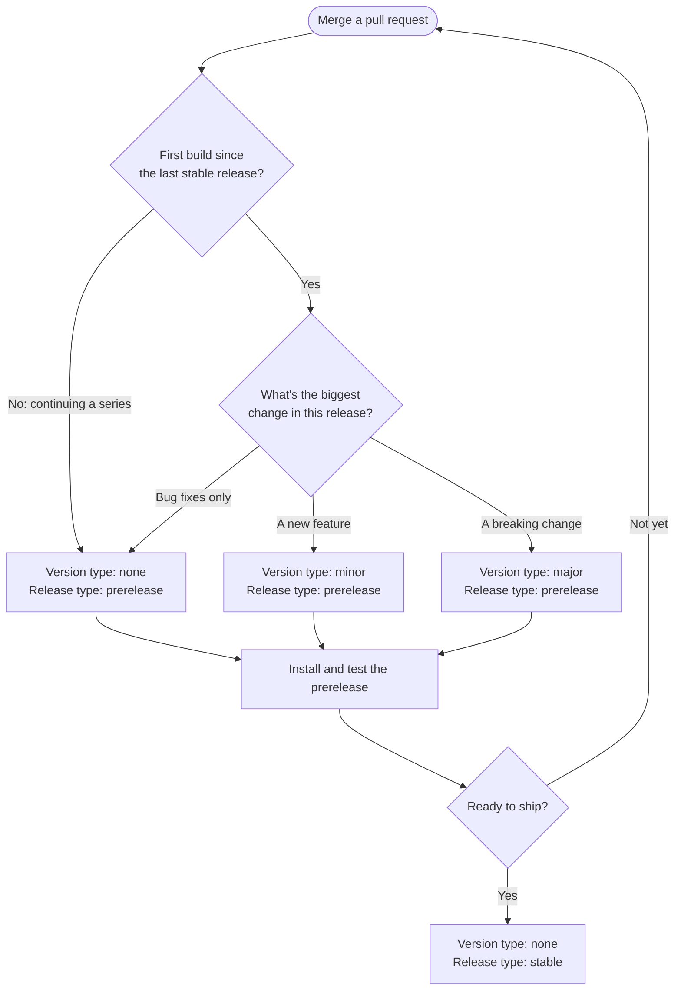

# Making the Most of Releases

The Build and Release form asks you to make choices every time you run it, and it isn't obvious which ones matter. This page is the practical version: what to pick, and when. The [Build and Release Guide](../build-and-release.md) has the full reference.

**The short version: leave the form at its defaults for almost every run.** You change **Version type** at most once per release, and **Release type** once, when you ship.

---

## The form

| Input | Default | When to change it |
| --- | --- | --- |
| **Version type** | `none` | Once, on the first build that adds a feature (`minor`) or a breaking change (`major`) |
| **Release type** | `prerelease` | When you're ready to ship, to `stable` |
| **Dependency source** | `required-resource-file` | Rarely. To try a newer ModuleForge before you pin it, use `psgallery-prerelease` |
| **Include source metadata** | On | Leave it on. It records the branch and commit in the package |
| **Feed name** *(Azure DevOps only)* | `psPackages` | Only if your feed has another name. Change the default in the pipeline file instead, so you never have to remember |

---

## The rhythm

Each release follows the same loop: a series of prereleases you test, then one stable release.

Here's how that looks over one release, starting from `1.2.3`:

| You did | Version type | Release type | Result |
| --- | --- | --- | --- |
| Merged a bug fix | `none` | `prerelease` | `1.2.4-prev001` |
| Merged another fix | `none` | `prerelease` | `1.2.4-prev002` |
| Merged a new function | **`minor`** | `prerelease` | `1.3.0-prev001` |
| Merged a fix to the new function | `none` | `prerelease` | `1.3.0-prev002` |
| Tested it, ready to ship | `none` | **`stable`** | `1.3.0` |

Two things make `none` the right default:

- **During a series, `none` continues it:** `1.3.0-prev001` becomes `1.3.0-prev002`.
- **After a stable release, `none` starts a patch series:** `1.3.0` becomes `1.3.1-prev001`. So bug fixes never need a version type at all.

---

## Mistakes worth avoiding

- **Choosing `minor` on every build.** Each `minor` starts a *new* minor version: `1.3.0-prev001`, then `1.4.0-prev001`, then `1.5.0-prev001`. Choose it once, on the first build with the new feature, then go back to `none`.
- **Choosing a version type when you ship.** When the latest version is a prerelease, a stable build promotes it as it is: `1.3.0-prev002` becomes `1.3.0`, whatever version type you pick. Leave it at `none`, and choose the version type earlier, while building prereleases.
- **Running Build and Release before Pester has finished.** Build and Release first checks the latest Pester run passed, for the commit you're building. Merge, wait for Pester, then run it. If you merged several pull requests in a row, run Pester on `main` by hand first. See [the FAQ](../faq.md).
- **Starting a new run after a failure.** If a run fails partway, use **Re-run failed jobs** on the same run instead. It finishes the version that run started, rather than using up another one.

---

## After the run

Each run adds a release to your repository's **Releases** page on GitHub, with:

- release notes built from your commit messages, which is why [commit prefixes](../commit-prefixes.md) matter,
- SHA256 checksums of the built module, see [Release Integrity](../Concepts/ReleaseIntegrity.md),
- the `.nupkg` package.

Prereleases are marked as pre-release there; a stable release becomes **Latest**. The package goes to your feed either way.

On Azure DevOps there's no Releases page: the run tags the commit with the version, pushes the package to your Artifacts feed, and shows a build summary, with the version, exports and checksums, on the run's **Extensions** tab. [Using Private Package Feeds](./private-package-feeds.md) covers installing it, and [Publishing to PSGallery](./github/psGallery-Release-Workflow.md) covers making a release public.

---

## Related

- [Build and Release Guide](../build-and-release.md): every combination, and what it produces
- [Module Versioning with SemVer](../Concepts/ModuleVersioning_With_SemVer.md): which changes are patch, minor or major
- [Commit Prefixes](../commit-prefixes.md)
